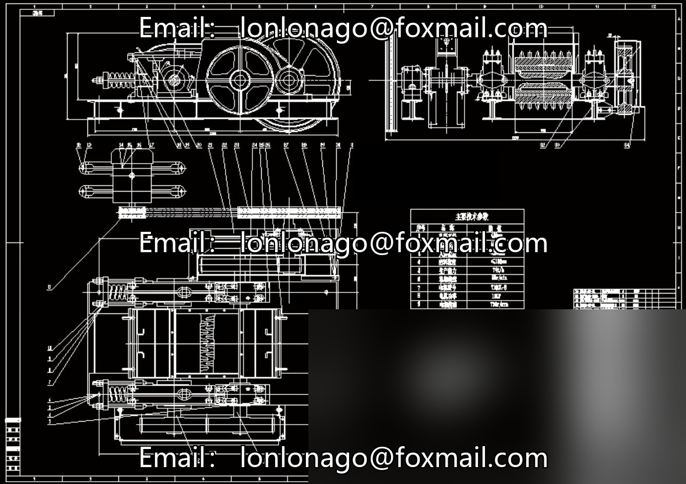
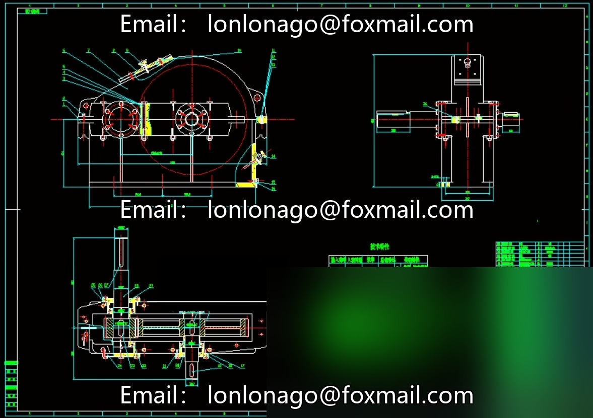

# Double-teeth roller crusher design, double-teeth roller crusher figure, double-teeth roller crusher design figure, double-teeth roller crusher design figure

## Body

Double-tooth roller crusher design, double-tooth roller crusher diagram, double-tooth roller crusher design diagram, double-tooth roller crusher design CAD diagram

The design covers single motor driving, a single-stage reduction gear, belt transmission, a pair of synchronized gears, and tooth roll plates and roll axes; the images show main technical parameters, component drawings and documents.

<!-- AI_ENRICHED -->

## Images

## Payment

Here is a pay link on Stripe ( https://buy.stripe.com/3cs8yP7sY87d0vu9AB ). Please contact me lonlonago@foxmail.com after funding $89, and I will send you a complete data files , thank you!

